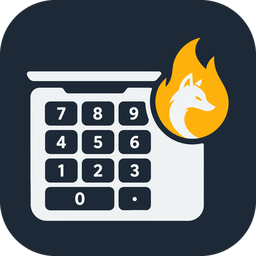

# Ogneliss NumTouch

[English](README.md) · **Русский**

Превращает тачпад ноутбука в цифровой блок. На тачпад наклеивается наклейка с клавишами; по горячей клавише тачпад переключается в режим NumPad, и касания областей наклейки становятся настоящими нажатиями клавиш — `7`, `Enter`, `Delete`, `Print Screen`, стрелки, сочетания вроде `Ctrl+C` или любой текст.

Программа не рисует клавиатуру на экране: она читает реальные касания физического тачпада и генерирует системные клавиатурные события.

> Прежнее название — *NumPad from TouchPad*. Настройки и раскладки старой версии переносятся автоматически при первом запуске.

## Платформы

| ОС | Статус | Требования |
|---|---|---|
| **Windows 10 1809+ / 11** (x64, ARM64) | основная; собирается и проходит самопроверку интерфейса в CI; автор подтвердил работу с тачпадом Apple (Precision Touchpad); полный чек-лист на оборудовании не пройден | Precision Touchpad (почти все ноутбуки последних лет) |
| **Linux** (x64, ARM64; X11 и Wayland) | собирается и проходит самопроверку в CI, на реальном тачпаде не проверялась | любой тачпад с мультитачем; группа `input` и правило udev (ставит `install.sh`) |
| **macOS 12+** (Apple Silicon, Intel) | прототип: собирается и запускается в CI, на MacBook не проверялся | разрешение «Универсальный доступ» |

## Установка

Скачайте файл для своей системы в разделе [Releases](../../releases).

- **Windows:** `OgnelissNumTouch-win-x64.exe` (или `-win-arm64`). Установщик и права администратора не нужны. Если сборка не подписана, при первом запуске SmartScreen покажет «Система Windows защитила ваш компьютер»: нажмите **Подробнее → Выполнить в любом случае**.
- **Linux:** распакуйте `OgnelissNumTouch-linux-x64.tar.gz` и выполните `./install.sh`. Программа ставится в `~/.local/bin`, ярлык — в меню; скрипт один раз через `sudo` добавляет вас в группу `input` и ставит правило udev для `/dev/uinput`. После этого выйдите из системы и войдите снова.
- **macOS:** распакуйте `OgnelissNumTouch-osx-arm64.zip` (Apple Silicon) или `-osx-x64.zip` (Intel), перенесите программу в «Программы». Выдайте разрешение **«Универсальный доступ»** (Системные настройки → Конфиденциальность и безопасность) и перезапустите программу. Неподписанную сборку в первый раз нужно открыть через контекстное меню → **«Открыть»**.

## Быстрый старт

1. Запустите программу — значок появится в трее (в строке меню на macOS).
2. На странице **«Главная»** выберите раскладку: **NUM10** (цифровой блок справа, слева — обычный трекпад), **NUM20** (полный блок с навигацией и стрелками) или **NUM30** (вместо стрелок — клавиши действий).
3. При необходимости настройте раскладку на странице **«Раскладки»**: перетаскивайте клавиши мышью, меняйте размер за угол, задавайте подпись и действие каждой клавиши.
4. Наклейте наклейку и пройдите **«Калибровку»**: коснитесь пяти подсвеченных клавиш, проверьте результат и сохраните.
5. Нажмите **Ctrl+Alt+N**: тачпад работает как цифровой блок, короткое экранное уведомление подтвердит режим. Ещё раз — обычный тачпад.

## Возможности

- **Редактор раскладок:** перемещение и размер клавиш за любой край или угол либо числами, «умная» привязка к соседним клавишам, промежутку раскладки, краям, одинаковому размеру и сетке (направляющие, линейки, подсказка с размером — в том числе в миллиметрах); промежутки, пропорции наклейки; назначение — клавиша (цифровой блок, навигация, F1–F24, буквы, модификаторы, мультимедиа), сочетание, ввод текста или пустая зона; подписи; отключение зон; автоповтор; отмена/повтор; импорт/экспорт; возврат к стандартным; проверка ошибок; касания тачпада видны поверх схемы ещё до сохранения.
- **Калибровка:** пять опорных клавиш → положение, масштаб и наклон наклейки; проверка «вхолостую»; ручные границы; отдельный профиль для каждого тачпада.
- Удержание, автоповтор, несколько пальцев одновременно, Shift/Ctrl на тачпаде.
- Настоящие клавиши цифрового блока (`Num 7`, `Num Enter`…), а не цифры основного ряда.
- В режиме NumPad курсор не прыгает, пока палец на клавишах (в Linux тачпад захватывается целиком, а «зона трекпада» NUM10 продолжает двигать курсор).
- Экранное уведомление при смене режима (отключается в настройках).
- Интерфейс на русском и английском: язык системы или выбранный в настройках.
- Режим выключается при блокировке и сне (Windows); ни одна клавиша не остаётся «зажатой».

## Ограничения

- Windows: старые тачпады без Precision Touchpad координаты касаний не отдают; нажатия не доходят до окон, запущенных от администратора (UIPI); `Ctrl+Alt+Del` сгенерировать нельзя; во время касания тачпада на мгновение блокируется и внешняя мышь.
- Linux: горячая клавиша не перехватывается (её получит и активная программа); ввод текста ограничен символами US-раскладки; нужны права группы `input`.
- macOS: приватный API MultitouchSupport — вне Mac App Store, может сломаться в новых версиях macOS; Print Screen и клавиш запуска приложений нет.

## Конфиденциальность

Работает офлайн. Журнал содержит только технические события; нажимаемые клавиши, введённый текст и координаты касаний не записываются.

## Для разработчиков

[BUILD.md](BUILD.md) — сборка; [DISTRIBUTION.md](DISTRIBUTION.md) — подпись и публикация для каждой платформы; [ARCHITECTURE.md](ARCHITECTURE.md) — устройство; [PLATFORM_FEASIBILITY.md](PLATFORM_FEASIBILITY.md) — возможности платформ; [TESTING.md](TESTING.md) — тесты и статус проверок; [AUDIT.md](AUDIT.md) — аудит исходных проектов; [CHANGELOG.md](CHANGELOG.md) — изменения.
